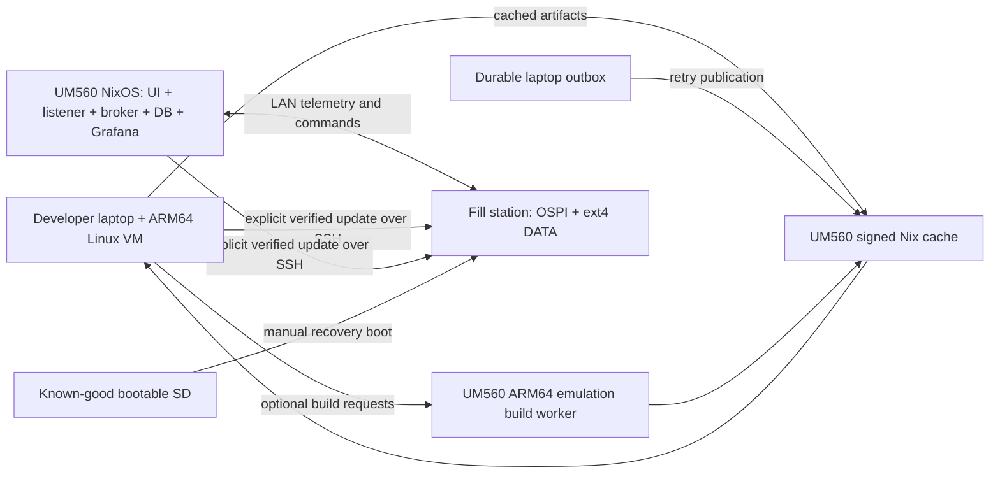

# Ground station, build cache, and fill-station deployment

Status: approved architecture; initial implementation committed, 2026-11-10.
Requirements below were confirmed with the user. The NixOS foundation and
build/cache CLI exist; the operational stack and station deployment remain pending.
This document describes the intended architecture, not a deployed system.
Use [the implementation checklist](../superpowers/plans/2026-11-09-ground-platform.md)
to track delivery and [the current deployment procedure](../operations/fill-station-deployment.md)
for commands that exist today.

## Implementation available now

- [Build/cache CLI](../../tools/platform/README.md): local build selection, frozen
  source snapshots, release manifests, registered GC roots and a durable pending
  publication queue, plus validated receipt acknowledgements. A real Liquid FIT
  build completed through this interface. The receipt receiver was separately
  exercised against that output using local Nix; station setup remains pending.
- [NixOS foundation](../../nix/nixos-configurations/ground-station/README.md): gated
  physical and VM targets, local status page, key-only SSH, optional signed cache
  and disabled-by-default worker. Hardware configuration and service migration
  are still required; the status page intentionally reports not ready.
- Explicit ARM64 and experimental x86 build graphs preserve the board target.
  Both x86 device-tree overlays built; complete x86 images and worker performance
  have not been validated.
- [Command listener](../../ground-station/LaunchButton/README.md): packaged,
  noninteractive, monitoring-only with current firmware. Operational commanding
  requires firmware session-protocol changes and owner-reviewed mappings.
- [Operator UI](../operations/operator-ui.md): packaged static React assets and
  opt-in NixOS nginx startup now exist. Validated public runtime settings replace
  the browser's fixed board address; missing settings show disconnected status.
  Browser and nginx routing checks passed. Offline tile preparation, kiosk and
  complete telemetry-stack startup remain pending; `/readyz` still returns 503.

The opt-in SSH cache ingestion/receipt module now exists, disabled by default;
see [cache acceptance](../operations/build-cache.md) before enabling it. A separate
disabled-by-default [worker endpoint](../operations/build-worker.md) now provides
runtime health and guarded admission. Live worker/containment and cache/signing
acceptance, remote output retention, prepared offline rebuilds,
deployment orchestration and CI cutover remain unfinished. Existing
FlakeHub-related CI remains until the replacement passes its acceptance tests.

## Confirmed requirements and evidence

- Ground station: user-reported MINISFORUM UM560 XT, Ryzen 5 5600H,
  16 GB RAM, 512 GB SSD; x86-64 NixOS, on the same LAN as the fill station.
  It is not available for live inspection yet.
- Both endpoints use Ethernet for normal networking. Migrate the fill station
  from its current Wi-Fi startup configuration to Ethernet; the mini PC gets
  network access over Ethernet, with no Wi-Fi association required. Exact wired
  interface names, MACs, switch ports and addresses are inventory work.
- Ground station starts Grafana, telemetry infrastructure, the operator UI,
  and the physical-command listener at boot without manual terminal commands.
- Both machines boot and run without internet or another machine being online.
  This means independent startup/local functions, not telemetry/commands across
  a disconnected link. A missing peer must be shown as disconnected/stale.
- Normal fill-station boot stays local. Network boot is optional development work.
- Replace the FlakeHub dependency with a ground-station-hosted binary cache;
  allow that machine to build when requested. Laptop builds remain possible.
- If the station is unavailable, retain new artifacts locally and publish them
  when connectivity returns. No successful local build should be lost because
  cache publication failed.
- Remove automatic expensive image builds from GitHub Actions; retain lightweight
  repository checks. Building or publishing is never permission to deploy.
- User reports SD boot, OSPI boot, SSH, persistent SSH, and dashboard operation
  worked. Code inspection and host tests are separate evidence. We have not
  demonstrated interrupted-update recovery or autonomous ground-station startup.
- Ext4 DATA and the root-directory permission correction are required parts of
  the current image. Standalone ADC diagnostics were retired; ADS7128 is an
  initialized-only selectable device, not a new telemetry channel mapping.
- Added user requirements: ground-station UI controls for Omada ES205GP PoE
  switches, wireless-link metrics for EAP215-Bridge KIT equipment, and controls
  for two Shelly Plug US Gen4 units. Device IPs will be supplied later. Switch
  count, bridge-kit count, hardware/firmware revisions and power/port topology
  have not been inspected; none of these integrations is implemented yet.

## Recommended division of responsibility

| Machine | Owns | Must not depend on |
| --- | --- | --- |
| Ground station | Local operator display, command listener, broker, database, Grafana, cache, optional build queue, release archive | Internet, FlakeHub, a laptop, fill-station availability for boot |
| Fill station | Local application, sensors/actuators, local failsafes, OSPI boot, persistent SSH/logs, update endpoint | Cache service, database, broker, ground-station availability for boot |
| Developer laptop | Editing, tests, optional local Linux builder, offline build preparation, durable publication outbox, operator-initiated deployment | Always-on ground station for every build |



## Ground-station startup and packaging

Use NixOS modules and supervised services. No npm/pip installs, image pulls,
flake updates, schema downloads, or tile downloads may be needed during boot.
Build the React UI ahead of time and serve its static output. Provision Grafana
datasources and dashboards from versioned files. Open the local UI in a kiosk
session after login/startup; services must also work headlessly.
Use a dedicated unprivileged operator account and explicit unattended kiosk
startup. Disable automatic suspend during field use, define display blanking,
and verify firmware power restoration after AC loss. No human login should
be needed to reach the operator screen.

For the first migration, preserve EMQX and PostgreSQL/Timescale semantics using
NixOS-managed OCI containers with immutable image digests and persistent volumes.
Keep Grafana in the same pinned stack initially. Acquire image archives during
the build/preparation step and load them locally; service startup must not contact
a registry. Do not swap broker/database products while migrating hosts. Decide
whether native services are worthwhile only after equivalent behavior is tested.
Portainer is not required for the operational stack. Camera/go2rtc and Home
Assistant integrations are separate opt-in modules, not silent deletions.

Systemd ordering is not a readiness test. PostgreSQL readiness precedes an
idempotent migration service; broker readiness precedes schema/rule provisioning;
Grafana provisioning and UI checks follow their dependencies. Failed prerequisites
produce visible degraded state, not a permanently spinning startup screen.
Keep telemetry collection running if the browser closes.

Package `ground-station/LaunchButton/pc_listener.py` with its Python dependencies
in Nix. Replace the hard-coded endpoint and interactive port prompt with runtime
configuration, a stable USB identity, and a bounded reconnect loop. The current
generic Pico matching can select the wrong device: prefer a unique serial number
and validated VID/PID/product combination. The service must not replay buffered
launch/arm/wipe commands on startup, restart, or reconnect. Readiness must not mean
armed. Keep physical enable/arming policy explicit and test with simulated peers.

Replace scattered IP literals with one station deployment configuration. Use
router DHCP reservations plus local DNS for stable identities; retain an explicit
IP override for recovery. Do not start a second DHCP server on an existing LAN.
Inventory ports before choosing reverse-proxy paths; WebSocket and Grafana
embedding behavior must be tested rather than assumed. Default to local map tiles
in field mode: `navigator.onLine` does not prove public tile-server reachability.

Database files, Grafana state, broker state, SSH host keys, and configuration
secrets persist outside immutable packages. Backups cover database-consistent
exports, service configuration, and restore instructions, not just the Nix store.
NixOS generation rollback does not roll back database migrations.

## Ethernet connections for the fill station and mini PC

Configure the mini PC's inspected wired NIC as its normal LAN/network connection;
scope NixOS addressing, routes and LAN service/firewall configuration to that
interface. Do not configure a required Wi-Fi connection or wait for wireless
association during startup. The fill station likewise moves normal SSH,
telemetry, commanding and network-delivered updates onto its inspected Ethernet
interface, for both Liquid and Hybrid profiles.

Current shared fill-station startup explicitly runs `wpa_supplicant` and DHCP on
`wlan0` in `nix/mixos-modules/fill-station-base/default.nix`. This is still current
code, not an implemented Ethernet migration. Verify the Ethernet driver/PHY,
carrier and actual interface name; configure wired addressing and prove SSH/data
connectivity before retiring Wi-Fi startup as the default. Keep serial recovery
and persistent keys/state intact. Any optional Wi-Fi recovery workflow is explicit
and separate from normal operation, rather than an automatic route dependency.

Record Ethernet MAC-based DHCP reservations/local DNS on the existing LAN, plus
the reviewed recovery addressing plan. Update service endpoints and SSH identity
records for the wired addresses without inventing IPs or interface names. Neither
machine's local boot may hang on cable absence, DHCP failure or an unavailable peer.
Verify cable unplug/replug, link recovery and operation without WAN or Wi-Fi.

Ethernet at each endpoint can still traverse an EAP215 wireless bridge between
LAN segments. Inventory the real topology before fixing that path in configuration;
the bridge-metrics requirement remains. Linux Ethernet networking does not require
enabling U-Boot network boot: the agreed SD/OSPI local-boot plan is unchanged.

## Network and power controls in the operator UI

Add a network/power panel to `Ground_Station_UI`, backed by a local supervised
service on the ground station. Keep device credentials in runtime secrets, with
device identities, endpoints and capability flags in the deployment configuration.
The browser uses the station backend; it does not hold device administrator
passwords or depend on cloud access. Unknown addresses remain unconfigured and
visibly unavailable, without blocking the rest of station startup.

| User-reported equipment | Planned UI behavior | Verification before implementation |
| --- | --- | --- |
| Omada ES205GP PoE switches; count pending | Named ports, observed PoE/link state, on/off and power-cycle buttons; power usage/budget where exposed | Actual revision/firmware, PoE-capable port mapping, local management interface and supported write API |
| Omada EAP215-Bridge KIT equipment; count pending | Both bridge ends, peer/link state, RF metrics and time-series trends; LAN latency/loss separately | Pair identities, roles, firmware, controller adoption and actual available metrics/MIBs |
| Two Shelly Plug US Gen4 units | Individually named on/off/power-cycle controls, observed relay state and available power/energy measurements | Exact model/mode, firmware, local API/authentication, load mapping and power-restore behavior |

The [ES205GP product documentation](https://www.omadanetworks.com/us/business-networking/omada-switch-agile/es205gp/)
lists four PoE-capable ports and web/controller management. That does not establish
a supported programmatic PoE-write interface for the installed units. Inventory
the hardware revision first; controller support/version requirements can differ.
Prefer a supported local controller interface when compatible; verify the actual
PoE endpoints before committing to an adapter. Do not assume this switch supports
SNMP writes or a generic API, and do not make undocumented web scraping the default.
If a local Omada controller is needed, package/pin it and retain its adoption data
as part of the offline station, rather than requiring an internet/cloud service.

The [EAP215-Bridge KIT documentation](https://www.omadanetworks.com/us/business-networking/omada-wifi-wireless-bridge/eap215-bridge-kit/v1/)
lists local/controller management and SNMP for the documented revision. Verify
availability on the installed revision and identify which local interface exposes
the bridge's peer statistics. Target RSSI/signal strength at both ends, SNR/noise,
negotiated TX/RX rates, traffic rates/counters, channel/width, uptime and disconnects
where exposed. Show unavailable fields explicitly. Label RF/negotiated rates
separately from measured traffic and from low-rate end-to-end RTT/packet-loss probes;
advertised 867 Mbps is not a measured link throughput. Active bandwidth tests are
maintenance actions, not an automatic startup or monitoring load.

The [Shelly Plug US Gen4 device documentation](https://shelly-api-docs.shelly.cloud/gen2/Devices/Gen4/ShellyPlugUSG4/)
identifies a local switch component and power meter. Prefer the documented local
[Switch RPC](https://shelly-api-docs.shelly.cloud/gen2/ComponentsAndServices/Switch/)
for explicit desired-state control and status, after validating firmware/mode and
authentication. Surface available power, energy, voltage/current and device faults
with units and freshness. The user reports the equipment is installed/hardwired;
verify management connectivity separately. These are Wi-Fi smart plugs, so do not
infer Ethernet management from mains/load wiring. Reuse an existing local Home
Assistant integration only if that becomes the reviewed adapter choice.

Before enabling writes, map every port/plug to its load and identify which ones
power the bridges, switch uplinks, ground station or control path. Distinguish
PoE power control from Ethernet-port administration and whole-device restart.
Clearly label the affected load and confirm disruptive off/cycle actions. A cycle
that cuts its own management path requires a verified device-local restore timer
or another recovery path; a browser-delayed follow-up `on` request is insufficient.

Commands originate from explicit operator actions, with bounded timeouts, duplicate
suppression and an audit/result record. Show requested and observed states
separately. If an acknowledgement is lost, show unknown/pending and read status;
do not blindly retry a cycle or toggle. No power action runs on boot, reconnect,
page load or stale telemetry. Do not enable autonomous PoE recovery rules while
adding manual controls. Offline/stale measurements never appear as healthy zeros.
Persist infrastructure metrics separately from fill-station/flight telemetry and
make them available to Grafana without changing the vehicle command protocol.

## Cache and builder are separate services

Recommendation: Harmonia serving the station's Nix store as a signed read-only
LAN binary cache, plus an authenticated SSH ingestion path. The cache is not
a build scheduler and does not accept arbitrary HTTP uploads. Cache signing keys
stay on the station outside the repository/Nix store; clients install its public
key. Keep public `cache.nixos.org` available in online mode. Removing FlakeHub
does not require removing Nix, flakes, or necessarily Determinate Nix.

Developers explicitly import locally built closures through an authorized account;
the station validates the artifact record and pins accepted paths before serving
them. Restrict ingestion/build access to people trusted to supply executable code.
Do not expose the cache or a privileged build account to arbitrary public PRs.
Signing cache objects is not approval to deploy them and does not authenticate
the FIT to U-Boot. Current FIT CRC32 checks detect corruption, not authenticity.

The UM560 is x86-64. The current MixOS configuration explicitly sets its build
platform to `aarch64-linux`. An HTTP cache can store outputs for both architectures,
but registering the x86 PC as an ARM builder does not make it compatible.

First prove the least-change ARM64 emulation path on NixOS using QEMU/binfmt.
Also evaluate an explicitly selected native x86-to-ARM cross-build configuration
before deciding the preferred worker: emulating all ARM build tools can erase
any advantage of the Ryzen CPU. A cross-build changes the derivation graph, so
record build platform and validate both vehicle images; do not promise identical
store paths or cache hits between different graphs. Do not advertise ARM KVM
capability on this x86 host. The user's signed-in Determinate Linux builder on
the Mac remains the accepted fallback. Station building stays disabled until
proven; cache/service migration can proceed using that existing builder.

Determinate's Native Linux Builder is a macOS feature backed by Apple's
Virtualization framework, not the service to install on the Linux mini PC.
NixOS can accept SSH builds directly; ARM compatibility is handled separately.
The [current Determinate documentation](https://docs.determinate.systems/determinate-nix/native-linux-builder/)
requires FlakeHub login for its Mac builder. This is separate from FlakeHub Cache.
The user explicitly accepts keeping their signed-in Determinate builder for
now; removing FlakeHub Cache does not require replacing that builder. Test its
offline credential/restart behavior as part of preparedness. An account-independent
self-managed VM is deferred, not a migration prerequisite.

During operations, suspend new heavy builds and cap the cache worker; telemetry
and commanding have priority. Nix job/core settings are parallelism hints, not
hard resource isolation. Enforce worker CPU/memory limits with a dedicated VM
or verified cgroup boundary (initial proposed ceiling: 6 GiB RAM and three CPU
cores). Do not assume limiting an SSH launcher limits the shared Nix daemon.
Until accepted numeric telemetry/command latency budgets and an isolated-worker
stress test pass, heavy builds are prohibited during field operations. On 16 GB RAM / 512 GB storage, reserve at least
100 GB free as an initial proposed disk guard, bound cache/log retention, and
measure database growth before fixing quotas. Cache garbage collection must
preserve active releases, pending transfers, recovery images, and prepared offline
build inputs. Database storage must not be evicted to make room for cache entries.

## One build interface and an explicit outbox

Implemented commands (see the CLI guide for configuration and limitations):

```text
./scripts/platform check
./scripts/platform build fill-station --vehicle liquid --artifact release --builder auto
./scripts/platform build ground-station --builder auto
./scripts/platform cache-sync
./scripts/platform status
```

The physical ground-station build requires inspected hardware configuration first.
`status` currently reports the local queue; it does not query a board. Planned
extensions, which are not commands yet:

```text
./scripts/platform prepare-offline --vehicle liquid
./scripts/platform deploy fill-station --vehicle liquid --target fillstation --release RELEASE
./scripts/platform deploy ground-station --target groundstation --release RELEASE
./scripts/platform status --target fillstation
```

`--vehicle` is always explicit for field releases; support Hybrid and Liquid.
`--artifact release` creates the OSPI bundle, SD recovery image, and DATA-only
image from the same pinned source. Normal code updates deploy only the FIT.
Use existing raw Nix attributes underneath; do not maintain a second build system.
Keep artifact links under a documented output directory, not many ambiguous
`result-*` links. Never silently deploy the newest directory or latest branch.

Each build records a versioned JSON manifest: release ID, vehicle, commit,
clean/dirty status, lock-file digest, profile digest, build platform/worker,
artifact/store paths, sizes, SHA256 hashes, bootloader version, tests, and
publication/deployment status. Dirty builds are explicitly development artifacts
and are not silently promoted to field releases. Keep source snapshots for
development builds so they remain traceable.

Build selection:
1. Reuse valid local store paths and reachable configured caches before scheduling
   compilation. Probe station reachability, build-platform support, free space,
   operational mode and availability with bounded timeouts.
2. In `auto`, prefer the station only after benchmarks establish it as faster for
   the requested workload and it is available for builds; otherwise prefer the
   laptop. If the preferred laptop has no compatible/healthy builder, use the
   validated station. Explicit `--builder local` / `--builder station` override
   preference and clearly report capability failures. Neither override changes
   cache availability or authorizes deployment. A missing local build platform
   is a scheduling condition, not a reason to first run a doomed compilation.
3. For a station-first configuration, skip an unreachable/busy station and use
   the signed-in local Determinate Linux builder. Test interaction between Nix
   SSH workers and Determinate's external builder; do not assume `max-jobs=0`
   alone provides the intended priority/fallback semantics.
4. If unavailable, omit it from this invocation; use public caches when online
   and the prepared local Linux builder for missing outputs. Do not leave an
   unreachable builder globally mandatory. Distinguish a failed build from a
   transport failure; never hide a compiler error by endlessly retrying elsewhere.
5. Fully offline, use only available inputs, local stores/file caches, and a
   compatible local builder. Report missing inputs before a long build attempt.
   Offline availability of a release does not imply arbitrary new source can build.
6. Pin a successful build immediately and record it in the local outbox before
   attempting upload. Publication failure leaves the build successful and queued.
7. On the next build or explicit `cache-sync`, retry queued imports, validate
   received closures, establish station GC roots/archive records, and remove the
   local pending pin only after acknowledgement. Transfers are idempotent.
   A timer is optional; every normal build checks the queue so retry does not
   depend on a laptop background service. Handle either end rebooting mid-copy.

Benchmark three repeatable workloads on the same source/lock/profile: clean
compilation with dependencies already available, incremental application change,
and a cache-only build. Separate initial downloads from compile time and include
queue/transfer overhead in end-to-end latency. Record native-cross versus emulated
station results and the Mac fallback, including peak RAM and operator-service
load. Select default routing from measured workloads, not CPU specifications.
Retest after major toolchain changes; cached results need no compiler routing.

Infrastructure-only failures (worker disappears, transport breaks, builder cannot
start) may trigger one bounded switch to a compatible fallback, retaining logs and
reusing valid completed paths. A compiler/test error or invalid derivation must
surface unchanged; do not silently rebuild on another machine or replay a failed
deploy. A second infrastructure failure stops with both diagnostic records.

Keep the durable outbox and its index under a user state directory, separate
from disposable symlink outputs. A GC root is a collector-recognized store root,
not just a JSON string containing a store path. Root the release closure and the
required prepared build inputs separately: final images intentionally discard
build references and do not retain their toolchains automatically.

`prepare-offline` fetches locked flake sources, source archives, compiler/runtime
inputs, language dependency closures, container archives, local map assets,
station NixOS closures, and the required platform-specific builder inputs. Export
an optional `file://` cache to external SSD and test import with networking disabled.
Cache-only operation cannot fetch a missing Git flake or registry image at boot.

## CI and release ownership

Target: keep `.github/workflows/repository-contract.yml` and fast host tests on PRs;
replace the every-branch image workflow with no automatic full-image build. A
manual release build can run through the same local interface on the station;
there is no need for an always-on privileged GitHub runner on the operator PC.
Disable `.github/workflows/nix.yml` only after the replacement and an offline
recovery release pass. Remove its FlakeHub action and document legacy GitHub
artifact retirement. Existing hosted artifacts are not the new release archive.

New commits do not automatically replace the active field release. Store
`candidate`, `tested`, and `active` labels separately. Cache sync cannot reboot
machines, activate a NixOS generation, flash partitions, or run DB migrations.

## Fill-station deployment choice

Keep OSPI boot as normal, ext4 DATA on SD for state/logs, and a distinct known-good
bootable SD for recovery. Speed is a user-observed preference; measure complete
boot-to-ready time as an acceptance test rather than claiming a fixed speedup.

The present updater already uploads over SSH, verifies SHA256, and uses `flashcp`
read-back verification. Improve orchestration rather than abandoning local boot:
check identity/vehicle/release, stage files, validate every affected partition
before any erase, require application safing/quiescence, write FIT, verify, then
perform an explicit reboot and a post-boot release/health check. Preflight includes
power, free staging space, `/proc/mtd` names/sizes, and SSH recovery access.
Use `all` only for provisioning or reviewed bootloader changes, not every edit.
Pin the deployment target's SSH host key; do not inherit a developer alias that
disables host verification. Some running update agent is necessary for remote
deployment: ordinary Linux SSH is the baseline, with bootable SD/serial recovery
when the installed system cannot start. No plan can SSH into a powered-off board.

The current single FIT slot is not atomic and has no automatic rollback. A power
failure during writing can require physical SD recovery. Current U-Boot tries
SD first, then OSPI, with no SD retry after OSPI fails. Do not call that A/B or
automatic SD failover. Keep bootloader updates as a distinct higher-impact step.

Investigate A/B FIT slots only as a separate milestone: current full-FIT slot is
55.75 MiB, so two images require measured size headroom, new partitioning,
redundant/validated boot-selection state, boot-success acknowledgement, bounded
attempts, and interruption tests. Do not shrink partitions or invent rollback by
changing just a shell script. Do not choose SD-root deployment merely to imply
atomicity; it also needs a validated update/rollback design.

Ground-station OS deployment uses prebuilt NixOS closures and explicit generation
activation over SSH or locally, with a known-good boot entry and local console
recovery. Test upgrade and rollback against database compatibility separately.

## Optional network-boot track

Not needed for the agreed target. Only add it if bench iteration speed justifies
extra machinery. It requires a network-enabled U-Boot (currently `CONFIG_NO_NET=y`),
working bootloader Ethernet/PHY support, a served known FIT, bounded network
attempts, and deterministic return to local boot when the server is absent.
Do not deploy an uncontrolled DHCP server on the shared LAN. Keep network boot
development-only unless independent offline local fallback is demonstrated.
SSH updates to Linux do not require bootloader network support.

## Sources and decision gates

- [Nix HTTP cache setup](https://nix.dev/tutorials/nixos/binary-cache-setup.html)
  establishes the separate cache and signing mechanism.
- [Harmonia upstream](https://github.com/nix-community/harmonia) describes serving
  the Nix store; it is the recommended implementation, not an upload queue.
- [Distributed builds](https://nix.dev/tutorials/nixos/distributed-builds-setup.html)
  describes SSH workers and daemon-side credentials/platform requirements.
- [Nix copy](https://nix.dev/manual/nix/2.35/command-ref/new-cli/nix3-copy)
  supports closure transfer and local `file://` caches.
- [Nix configuration](https://nix.dev/manual/nix/2.35/command-ref/conf-file.html)
  documents timeouts, signature trust, builder configuration, and source fallback.

Before implementation: review Harmonia vs the simpler nix-serve alternative;
confirm which existing station data/services must migrate; inventory the PC's
NIC/disk/display/USB identities; choose hostname/IP reservations and administrator
keys. Confirm command-listener arming/reconnect behavior with its owner. The
concrete service/container pins and resource limits are established during that
inventory, not fabricated here. These gates do not prevent drafting the module
and wrapper interfaces, but block an operational deployment.
