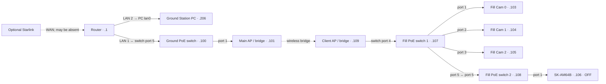

# Ground-station network and device reference

Updated November 13, 2026 from the operator's device list, wiring description and
subsequent corrections. Statuses below are operator-reported, not a network scan.
The SK-AM64B is currently off; all other addressed devices below are reported up.

## Address and login lookup

| Device | IPv4 address | Username | Role / model |
| --- | --- | --- | --- |
| Ground Station PC | `192.168.1.206` | `ground-admin` | MINISFORUM UM560 XT; NixOS; router LAN 2; Ethernet `lan0` |
| SK-AM64B | `192.168.1.106` | Not supplied | Fill-station board; currently off; fill switch 2 port 1 |
| Fill Cam 0 / `fillcam0` | `192.168.1.103` | `admin` | Camera; fill switch 1 port 1 |
| Fill Cam 1 / `fillcam1` | `192.168.1.104` | `admin` | Camera; fill switch 1 port 2 |
| Fill Cam 2 / `fillcam2` | `192.168.1.105` | `admin` | Camera; fill switch 1 port 3 |
| Router | `192.168.1.1` | `CornellRocketry` | Ground-side LAN; optional future Starlink WAN |
| Main AP / ground-side wireless bridge | `192.168.1.101` | `CornellRocketry` | Omada EAP215-Bridge KIT unit; ground switch port 1 |
| Client AP / fill-side wireless bridge | `192.168.1.109` | `CornellRocketry` | Omada EAP215-Bridge KIT unit; fill switch 1 port 4 |
| Ground-side PoE switch | `192.168.1.100` | `CornellRocketry` | Omada ES205GP; port 5 to router LAN 1 |
| Fill-side PoE switch 1 | `192.168.1.107` | `CornellRocketry` | Omada ES205GP; cameras, client AP, switch-2 uplink |
| Fill-side PoE switch 2 | `192.168.1.108` | `CornellRocketry` | Omada ES205GP; SK-AM64B and switch-1 uplink |

The SK-AM64B image now selects Ethernet DHCP rather than Wi-Fi. `.106` remains
the intended address until its actual wired lease/MAC and router reservation are
checked. See [board Ethernet setup](../../fill-station/docs/ETHERNET_SETUP.md).
| Shelly smart plug 1 | Not supplied | Not supplied | Shelly Plug US Gen4; address/load mapping to follow |
| Shelly smart plug 2 | Not supplied | Not supplied | Shelly Plug US Gen4; address/load mapping to follow |

The AP management portal used by the operator is **https://omadaap.net**.
Keep the individual AP addresses above as the unit identifiers; portal selection
and its offline behavior have not been independently checked. Camera login pages
are believed to use HTTP; that protocol and exact camera models remain unverified.
Router/switch management HTTP versus HTTPS was not supplied.

The earlier `.107` username and `.108` password spellings were typing errors.
The operator explicitly corrected the shared sandbox password and normalized
router/AP/switch usernames to `CornellRocketry`. Cameras remain `admin` and the PC
remains `ground-admin`. The exact shared password is recorded in the local file
below, without duplicating it in this repository.

### Local credential reference

On the development Mac:

```text
~/.config/cornell-rocketry/ground-station/sandbox-network-credentials.json
```

If `XDG_CONFIG_HOME` is set, use its equivalent `cornell-rocketry/ground-station/`
subdirectory. This owner-only JSON reference contains the corrected common
sandbox password and each supplied device's username/address. The PC password is
for console login; its configured SSH access remains contributor-key-only.
The SK-AM64B's login method was not supplied in this inventory. Smart-plug logins
are also unconfirmed. No live device account/password changes were performed.

This file is an operator reference, not yet a runtime configuration consumed by
NixOS camera or network-device adapters. The independently generated EMQX,
database and Grafana service secrets remain in
`/var/lib/ground-station/telemetry-secrets.json` on the mini PC; the shared device
login password does not replace them.

## Physical topology

Port labels below follow the operator's physical numbering. VLAN assignments,
DHCP/static configuration and exact firmware revisions have not been inspected.



All abbreviated addresses in the diagram start with `192.168.1.`. The mini PC's
cable goes directly to the router, rather than through the ground PoE switch.
Communication with the fill side still traverses the wireless bridge even when
the PC and SK-AM64B endpoints use Ethernet.

## Port map

### Router — `192.168.1.1`

| Port / role | Connection |
| --- | --- |
| WAN connection(s) | Optional future Starlink; exact WAN socket assignment not supplied |
| First LAN port / LAN 1 | Ground PoE switch `.100`, port 5 |
| Second LAN port / LAN 2 | Ground Station PC `.206`, Ethernet `lan0` |
| Other ports | Not specified |

### Ground PoE switch — `192.168.1.100`

| Port | Connection |
| --- | --- |
| 1 | Main AP / ground-side wireless bridge `.101` |
| 2 | Not specified |
| 3 | Not specified |
| 4 | Not specified |
| 5 | Router `.1`, LAN 1 |

### Fill PoE switch 1 — `192.168.1.107`

| Port | Connection |
| --- | --- |
| 1 | Fill Cam 0 `.103` |
| 2 | Fill Cam 1 `.104` |
| 3 | Fill Cam 2 `.105` |
| 4 | Client AP / fill-side wireless bridge `.109` |
| 5 | Fill PoE switch 2 `.108`, port 5 |

### Fill PoE switch 2 — `192.168.1.108`

| Port | Connection |
| --- | --- |
| 1 | SK-AM64B `.106`; board currently off |
| 2 | Not specified |
| 3 | Not specified |
| 4 | Not specified |
| 5 | Fill PoE switch 1 `.107`, port 5 |

“Not specified” does not mean a port was observed empty. Actual PoE delivery,
per-port power and firmware/API control capabilities have not been measured.
Do not infer that every numbered port supports PoE from its cable assignment.

## Operation with or without Starlink

The router LAN and wireless bridge connect the local devices. Starlink is an
optional WAN uplink; local station boot, operator UI, telemetry storage and camera
streaming must work with that WAN disconnected. WAN access may be used while
preparing packages or updates, but must not become a field-startup dependency.

The mini PC is configured for IPv4 DHCP and was observed at `192.168.1.206/24`.
Its Ethernet MAC is `58:47:CA:7E:6E:15`. The SK-AM64B wired interface is `eth0`,
MAC `28:b5:e8:e3:80:8f`. The operator configured its router reservation; a serial
DHCP probe obtained `192.168.1.106` from `192.168.1.1`. That probe used a no-op
lease script, so it did not apply the address or prove routed traffic. Other
DHCP reservations/local DNS have not been verified. Keep the documented
addresses stable: the services profile's Grafana root URL currently uses `.206`.
No router, DHCP, VLAN or AP settings were changed while recording this reference.

The reported SK-AM64B-to-broker path is switch 2 → switch 1 → client bridge →
main bridge → ground switch → router → mini PC. The physical `eth0` link and DHCP reservation are confirmed from operator output.
The operator subsequently confirmed the updated Liquid OSPI image acquires .106,
reaches .206, permits wired SSH, and sends live telemetry visible in FillOps.
Ethernet, SSH and advancing telemetry returned after a further board reboot.

## Cameras and the current dashboard

| Stream name | Current camera | Legacy source address | Legacy RTSP path |
| --- | --- | --- | --- |
| `fillcam0` | `.103` | `192.168.8.206` | `/Preview_01_main` |
| `fillcam1` | `.104` | `192.168.8.137` | `/Preview_01_main` |
| `fillcam2` | `.105` | `192.168.8.185` | `/Preview_01_main` |

The path and stream identifiers come from the existing
[`go2rtc.yaml`](../../ground-station/go2rtc.yaml). The operator reports the same
cameras are in use. That makes the old RTSP path a candidate for the new addresses;
it does not verify current RTSP access, port, codec or camera configuration. The
legacy URLs omitted an explicit port. Their old credentials are not the corrected
current login reference.

The manual [`grafana.json`](../../ground-station/grafana.json) embeds a go2rtc
relay at **`192.168.8.193:1984`**, with `fillcam0` through `fillcam2`. That relay
address is historical, not a newly verified current device. The current NixOS
profile does not run that relay, and its packaged camera panel intentionally says
it is unconfigured. Camera web login from the laptop does not establish stream
access from a relay on the mini PC.

The new camera integration should use the `.103`–`.105` endpoints and corrected
private logins, retain these stream identifiers, and keep device credentials out
of browser/dashboard URLs. Camera models, live RTSP support and browser playback
still need verification. The Shelly plugs can be added once their addresses and
load assignments are supplied.

## Control-path implications

| Link | Effect of losing that link |
| --- | --- |
| Ground switch port 1 / main AP | Wireless bridge and any clients using that AP can lose connectivity |
| Fill switch 1 port 4 / client AP | Ground-side access to fill-side cameras, switches and board can be lost |
| Fill switch 1 port 5 ↔ switch 2 port 5 | Disconnects the downstream switch and SK-AM64B from the upstream fill LAN |
| Router LAN 2 | Disconnects the mini PC's wired connection |

Use these labels when implementing PoE/link controls. In particular, switching
off a device carrying the management path may prevent a later remote “on” command;
that path needs a device-local timed cycle or on-site recovery. These port controls
are not currently implemented or enabled. Bridge radio metrics and Shelly controls
also remain separate integrations; IP knowledge alone does not verify their APIs.

## Ground-station software status

The operator confirmed NixOS SSD boot, console/SSH access, Ethernet `.206`, the
operator UI, active telemetry provisioners/containers and successful Grafana
storage health. After setting the services generation as the persistent boot
default and rebooting, the operator confirmed all six telemetry units active and
the FillOps dashboard loading. This confirms automatic startup across reboot;
physical board ingestion was subsequently confirmed by advancing
`ms_since_boot_fill` in FillOps, including recovery after a board reboot.

Open the current FillOps dashboard directly at
**http://192.168.1.206:8080/grafana/d/adrc2lg/fillops**. The default-home fix is
verified in local code for a future update, not yet applied to the running PC.
Camera relay/playback, physical PRU waveform timing, kiosk, network-device controls,
signed cache/build worker and Secure Boot remain unaccepted or unconfigured.

See the [services update guide](ground-station-update.md),
[telemetry runbook](telemetry-stack.md), and
[installation/recovery guide](ground-station-install.md).


## Infrastructure adapter research (not device acceptance)

The ES205GP's published specifications list local web-based management and
PoE recovery capabilities; this does not establish a stable local write API or
SNMP control on the installed revision. Implement the PoE adapter only after
recording the actual hardware/firmware and verifying its local requests.
[Official ES205GP specifications](https://www.tp-link.com/us/business-networking/omada-switch-agile/es205gp/).

The EAP215-Bridge product specifications advertise SNMP, including v1/v2c/v3 on
listed revisions. Actual enabled access, credentials, available MIBs and RF
fields still need inspection; LAN ping must not be labeled as RSSI or RF quality.
[Official EAP215-Bridge specifications](https://www.tp-link.com/uk/business-networking/omada-wifi-wireless-bridge/eap215-bridge-kit/).

No switch/AP/Shelly write adapter is activated by the display/camera update.
The main/client bridge power paths and PoE capability/load mapping require the
control-path precautions recorded above. The SK-AM64B Ethernet cable has not
been established as a source of board power.
